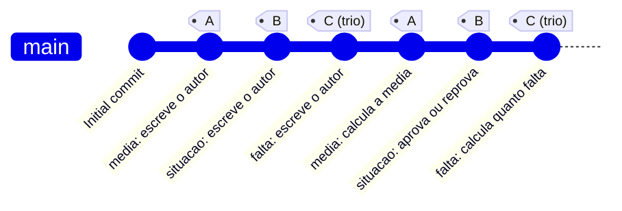

<div align="center">

# 📘 Boletim da dupla · Git passo a passo

**Cada um escreve uma função, num arquivo só seu. O grupo junta tudo com Git.**


IFRN · Introdução à Programação · INFO 1M e INFO 1V

[🎞️ **Abrir os slides da aula**](https://demetrioscoutinho.github.io/portfolio/int_prog/slides/aula-git-boletim.html)

</div>

---

> [!WARNING]
> **Não edite este README.** Também não edite o `main.py`. Um commit seu em qualquer arquivo que não seja o **seu** tira os 20 pontos de "só mexeu no seu arquivo".

## 🔗 Links úteis

| O quê | Onde |
|---|---|
| 🎞️ Slides da aula (passo a passo, com simulador) | [aula-git-boletim.html](https://demetrioscoutinho.github.io/portfolio/int_prog/slides/aula-git-boletim.html) |
| 📦 Este modelo no GitHub | [DemetriosCoutinho/boletim-git-template](https://github.com/DemetriosCoutinho/boletim-git-template) |
| 🔒 Esconder o seu e-mail no GitHub | [Docs: e-mail privado](https://docs.github.com/pt/account-and-profile/setting-up-and-managing-your-personal-account-on-github/managing-email-preferences/setting-your-commit-email-address) |
| ⬇️ Git | [git-scm.com/downloads](https://git-scm.com/downloads) |
| ⬇️ Python 3 | [python.org/downloads](https://www.python.org/downloads/) |
| ⬇️ Visual Studio Code | [code.visualstudio.com](https://code.visualstudio.com/) |

## 👥 Quem faz o quê

| Papel | Arquivo | O que a função faz |
|:---:|---|---|
| 🔵 **Aluno A** | `media.py` | calcula a média das duas notas |
| 🟠 **Aluno B** | `situacao.py` | diz se o aluno foi aprovado |
| 🟢 **Aluno C** (só no trio) | `falta.py` | diz quantos pontos faltam para 60 |

- O `main.py` já está pronto: ele lê as notas e chama as funções. **Ninguém mexe nele.**
- Na **dupla**, o `falta.py` fica como veio e o programa mostra `Falta: ?`. É o esperado.
- Escreva o seu nome na linha 1 do **seu** arquivo, depois de `# Autor:`. O professor confere o papel de cada um pelo Git: **vale o git**.

## 🗺️ Ordem do trabalho



| Etapa | O que acontece |
|:---:|---|
| **1** | O Aluno A cria o repositório do grupo a partir deste modelo e convida os colegas. Cada um aceita o convite. |
| **2** | Cada um faz `clone` no seu computador e configura nome, e-mail e `pull.rebase`. |
| **3** | Cada um escreve o seu nome no **seu** arquivo e faz o primeiro commit. |
| **4** | Um de cada vez: `pull` e `push`. O segundo a enviar vê o push recusado e aprende a resolver. |
| **5** | Cada um escreve a **sua função** e testa com `python main.py`. |
| **6** | Todos fazem `pull` e rodam o programa completo. |

Os comandos de cada passo estão nos **[slides](https://demetrioscoutinho.github.io/portfolio/int_prog/slides/aula-git-boletim.html)**: siga na ordem, sem pular, e **espere** quando o slide mandar.

## 📤 Entrega no Google Classroom

Até **terça-feira, 24/11, às 23:59**. A entrega é **individual**: cada aluno envia, na atividade do Classroom:

1. 🔗 o **link do repositório** do grupo (o repositório é público: o professor abre sem convite);
2. 👤 o seu **usuário do GitHub**;
3. 🏷️ o seu **papel** (Aluno A, B ou C).

### Como a nota é calculada (100 pontos, individual)

| Item | Pontos |
|---|:---:|
| Um commit seu com o seu nome em `# Autor:` no seu arquivo | **20** |
| A sua função passa nos testes do professor (inclusive o 60 exato e valores com `.5`) | **40** |
| Você só mexeu no seu arquivo | **20** |
| Pelo menos 2 commits seus no GitHub | **20** |

## 💻 Instalar no seu computador

No laboratório, tudo já está instalado. **Em casa**, instale as três ferramentas abaixo, uma vez. Abra o bloco do seu sistema.

<details>
<summary><b>Windows</b> (10 ou 11)</summary>

1. **Git:** baixe em [git-scm.com/downloads](https://git-scm.com/downloads) e clique em *Next* até o fim (as opções padrão servem). Ou, no **Terminal**: `winget install --id Git.Git -e`
2. **Python 3:** baixe em [python.org/downloads](https://www.python.org/downloads/). Na primeira tela, **marque "Add python.exe to PATH"** e clique em *Install Now*. Ou: `winget install --id Python.Python.3.12 -e`
3. **Visual Studio Code:** baixe em [code.visualstudio.com](https://code.visualstudio.com/) e instale. Ou: `winget install --id Microsoft.VisualStudioCode -e`
4. Abra o VS Code, clique no ícone de **Extensões** (`Ctrl+Shift+X`), procure **Python** (Microsoft) e clique em *Install*.
5. **Feche e abra o terminal de novo**, para ele enxergar o que acabou de instalar. Confira:

```
git --version
py --version
```

> [!TIP]
> No Windows, se `python main.py` abrir a Microsoft Store ou não mostrar nada, use `py main.py`: faz a mesma coisa.

</details>

<details>
<summary><b>macOS</b></summary>

1. **Git:** abra o **Terminal** e rode `xcode-select --install`. Confirme a janela que abrir. Ou, com o [Homebrew](https://brew.sh/): `brew install git`
2. **Python 3:** baixe em [python.org/downloads](https://www.python.org/downloads/) e abra o instalador. Ou: `brew install python`
3. **Visual Studio Code:** baixe em [code.visualstudio.com](https://code.visualstudio.com/), abra o `.zip` e arraste o app para a pasta **Aplicativos**. Ou: `brew install --cask visual-studio-code`
4. Abra o VS Code, clique no ícone de **Extensões** (`Cmd+Shift+X`), procure **Python** (Microsoft) e clique em *Install*.
5. **Feche e abra o Terminal de novo.** Confira:

```
git --version
python3 --version
```

> [!TIP]
> No macOS o comando costuma ser `python3` (e `python3 main.py`). Se `python` funcionar no seu, tudo bem também.

</details>

<details>
<summary><b>Linux</b> (Ubuntu, Debian e derivados)</summary>

1. No terminal, instale o Git e o Python 3:

```
sudo apt update
sudo apt install git python3
```

2. **Visual Studio Code:** baixe o pacote `.deb` em [code.visualstudio.com](https://code.visualstudio.com/) e instale com `sudo apt install ./arquivo.deb` (use o nome do arquivo que você baixou). Ou, se o seu sistema usa Snap: `sudo snap install code --classic`
3. Abra o VS Code, clique no ícone de **Extensões** (`Ctrl+Shift+X`), procure **Python** (Microsoft) e clique em *Install*.
4. Confira:

```
git --version
python3 --version
```

> [!TIP]
> No Linux o comando costuma ser `python3` (e `python3 main.py`).

</details>

### 🔐 Entrar no GitHub pelo VS Code

No VS Code, clique no ícone de **Contas** (canto inferior esquerdo) > **Sign in with GitHub to use GitHub...** e autorize no navegador. Assim o primeiro `git push` já funciona, sem digitar senha.

## 🐙 Configurar a sua conta do GitHub (uma vez)

1. Crie a conta em [github.com/signup](https://github.com/signup).
2. Abra **Settings > Emails** e ligue **Keep my email address private**.
3. Copie o endereço que aparece no formato `ID+USUARIO@users.noreply.github.com` e guarde: você usa ele no passo 2 da aula (`git config user.email`). Isso evita publicar o seu e-mail pessoal nos commits.

## 🛟 Problemas comuns

| Sintoma | O que fazer |
|---|---|
| `python main.py` abre a Microsoft Store ou não mostra nada (Windows) | Use `py main.py`. |
| `python: command not found` (macOS e Linux) | Use `python3 main.py`. |
| `rejected ... (fetch first)` no `git push` | Faça `git pull` e depois `git push` de novo. Esse erro faz parte da aula. |
| `Please tell me who you are` no `git commit` | Refaça `git config user.name` e `git config user.email` (passo 2 da aula). |
| O convite do colega não chegou | Abra [github.com/notifications](https://github.com/notifications) e clique em **Accept invitation**. |
| Apareceu um arquivo que não é o seu em `git status` | **Pare** e chame o professor, antes de fazer commit. |

> [!IMPORTANT]
> **No computador do laboratório**, antes de levantar: saia da sua conta do GitHub no VS Code e remova a credencial em **Painel de Controle > Contas de Usuário > Gerenciador de Credenciais**. O computador é de todo mundo.

---

<div align="center">

Dúvidas? Pergunte ao professor ou volte aos **[slides da aula](https://demetrioscoutinho.github.io/portfolio/int_prog/slides/aula-git-boletim.html)**.

</div>
